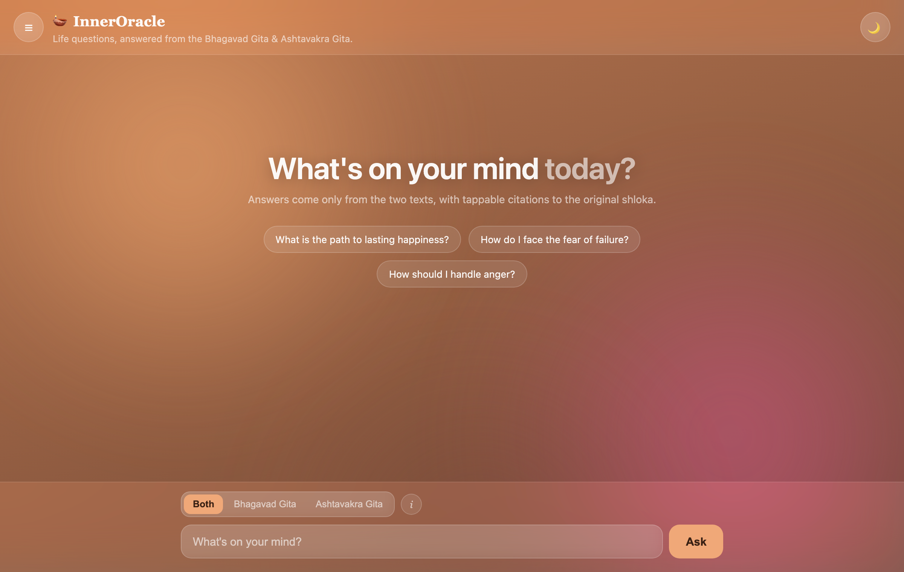
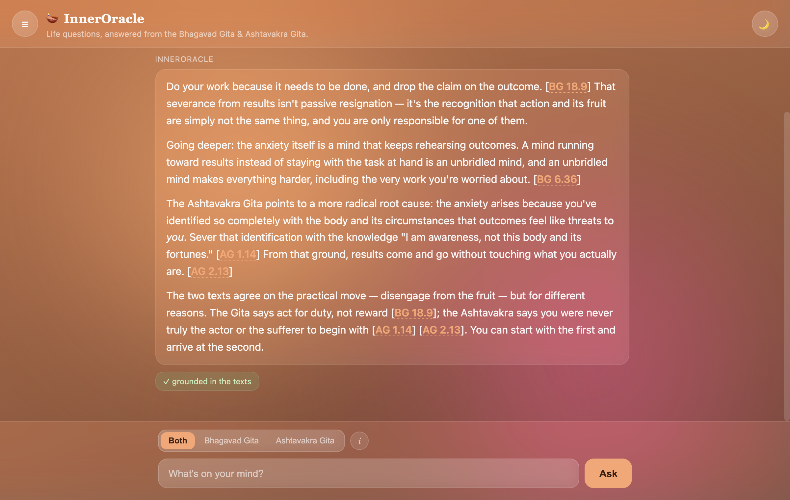
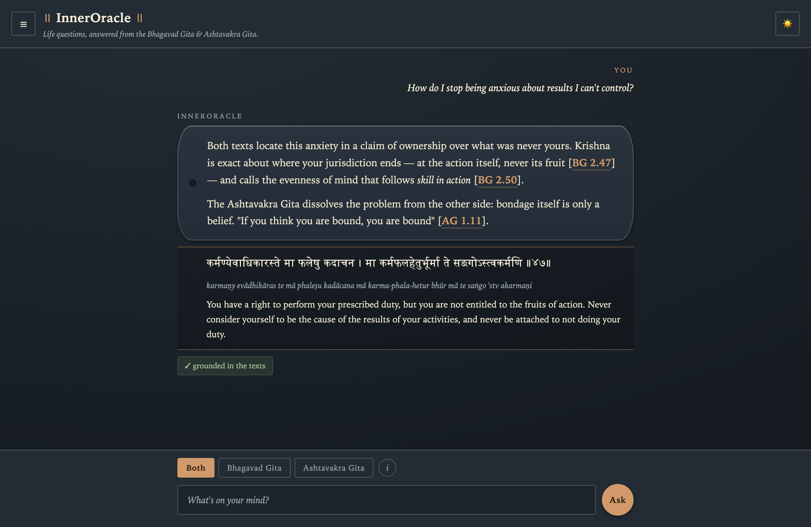
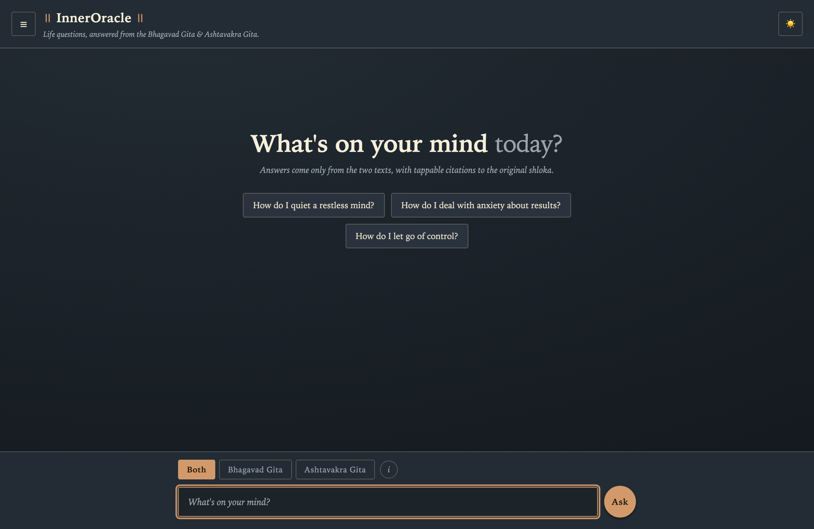
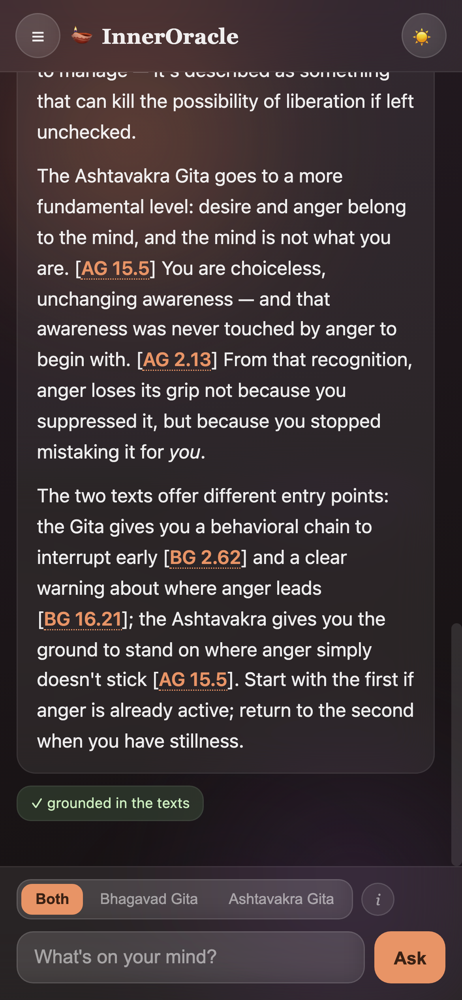
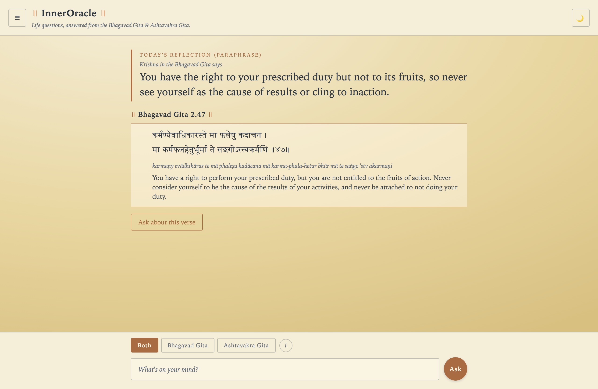
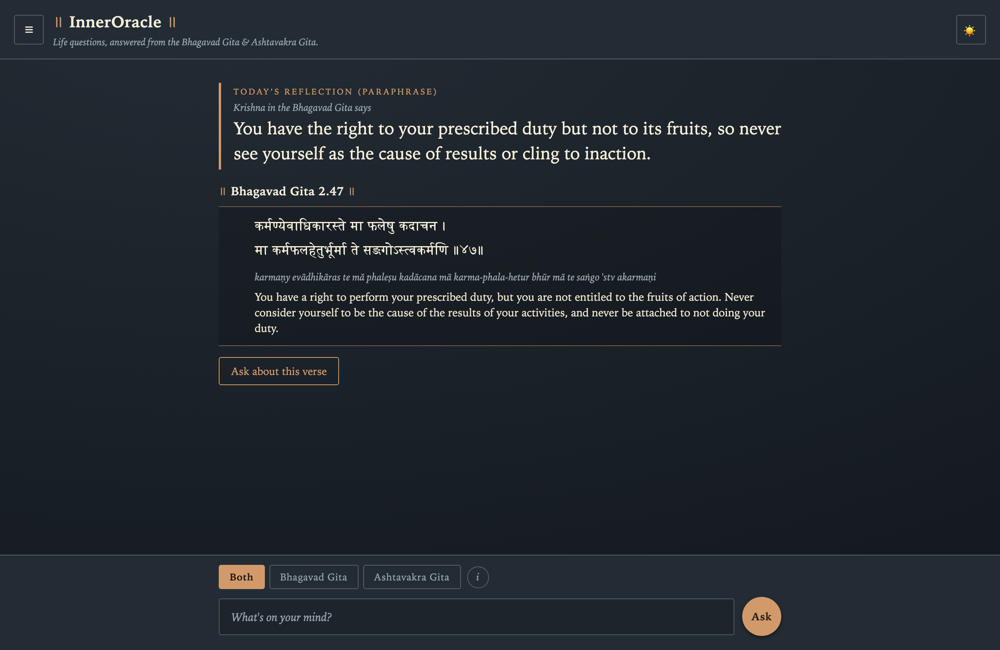
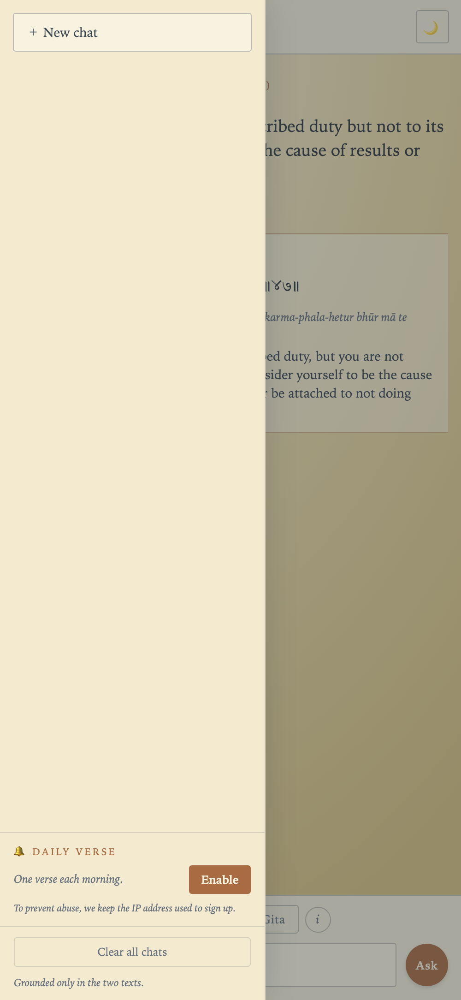

<div align="center">

# 🪔 InnerOracle

**Life questions, answered only from the Bhagavad Gita & the Ashtavakra Gita — with every claim cited to the verse it came from.**

### [→ Try it live at inneroracle.cc](https://inneroracle.cc)

</div>



---

## What it is

InnerOracle is a grounded AI assistant for life questions. Instead of answering from a
model's general knowledge, it retrieves relevant verses from two classical wisdom texts —
the **Bhagavad Gita** and the **Ashtavakra Gita** — and answers *strictly* from them, citing
each claim inline. When the two texts disagree, it shows both perspectives rather than
blending them. When the texts don't cover something, it says so instead of guessing.

Ask anything — *"How do I deal with anxiety about results?"*, *"What is the self?"*,
*"How should I handle anger?"* — and get a concise, sourced answer you can trace back to the
original Sanskrit.

## What makes it different

- **📖 Grounded, not guessed** — answers come only from the retrieved verses. Every
  substantive claim carries an inline citation like `[BG 2.47]` or `[AG 1.15]`.
- **✅ Self-checking** — a separate model verifies each answer against the source verses and
  shows a *"grounded in the texts"* / *"check sources"* badge, so you know how trustworthy it is.
- **🔍 Tap to see the shloka** — tap any citation to reveal the original Devanagari verse,
  transliteration, and translation.
- **⚖️ Honest contrast** — the Gita's path of selfless action vs. the Ashtavakra Gita's
  non-dual "you were never the doer" — presented side by side. Focus on one text or compare both.
- **💬 Remembers the conversation** — ask follow-ups like *"tell me more"* or *"what about anger?"*
  and it keeps context.
- **🔒 Private by design** — conversations live only in your browser; nothing is stored on a server.

## See it in action

**A grounded answer** — inline citations to each verse and a *"grounded in the texts"*
verification badge. Light and dark themes:

<table>
  <tr>
    <td width="50%"></td>
    <td width="50%"></td>
  </tr>
</table>

**Welcome screen** — dark theme:



**On mobile:**



## How it works

```
your question
   → (for follow-ups) rewritten into a standalone search query
      → hybrid retrieval: dense semantic + keyword search, fused and balanced across both texts
         → the model writes a concise answer grounded in those verses, streamed live
            → a verifier checks the answer against the verses → "grounded" / "check sources" badge
```

Sanskrit shlokas are kept separate from translations and commentary when the texts are
ingested, then recombined into full verse context at answer time — so retrieval stays precise
while answers stay readable.

## Built with

**Retrieval-Augmented Generation** · **Anthropic Claude** (answers + verification) ·
**FastAPI** with live token streaming · **Qdrant** hybrid vector search (semantic + keyword,
RRF fusion) · **ONNX** embeddings · **SQLite** · a dependency-light **vanilla-JS** web app ·
deployed with **Docker** behind a **Cloudflare Tunnel**.

## Daily verse

Install the site to your phone's Home Screen and you can opt in to two notifications a day,
morning and evening, each a short paraphrase of a different verse ("Krishna in the Bhagavad
Gita says …") that opens the real verse when tapped. A speaker is named only where it has been hand-checked; otherwise the
title simply reads "The Bhagavad Gita says" or "The Ashtavakra Gita says". It's self-hosted
web push, with no third-party notification service.

**Tapping a notification** opens the verse: its reflection on top, then the original
shloka, transliteration and translation, with a button to ask about it. Light and dark themes:

<table>
  <tr>
    <td width="50%"></td>
    <td width="50%"></td>
  </tr>
</table>

**Turning it on** — from the menu (shown on mobile):



**Privacy:** to prevent abuse, the IP address used to sign up is kept for 7 days, then only
in hashed form for 90 days. You can turn notifications off anytime from the menu.

---

<div align="center">
<sub>Made with care for the texts. Answers are for reflection, not a substitute for a teacher.</sub>
</div>
